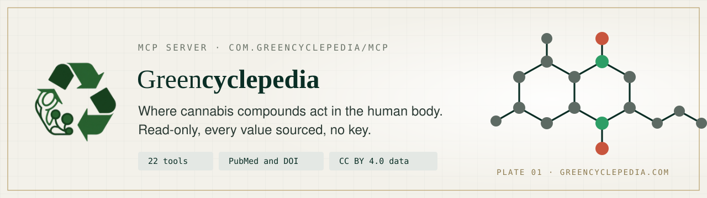

<p align="center">
  <a href="https://greencyclepedia.com/"></a>
</p>

<p align="center">
  <a href="https://registry.modelcontextprotocol.io/v0.1/servers?search=com.greencyclepedia/mcp"></a>
  
  
  
  <a href="https://creativecommons.org/licenses/by/4.0/"></a>
  <a href="LICENSE"></a>
  <a href="https://github.com/Moses10119/greencyclepedia-mcp/actions/workflows/live-check.yml"></a>
</p>

# Greencyclepedia MCP server

Your AI assistant answers cannabis science questions from sourced records: compounds, receptors, body structures, studies and trials, every value with its PubMed or database source. Free, read only, no key, no sign up.

The server runs at `https://greencyclepedia.com/mcp`. This repository holds its listing, [worked examples](examples/README.md) and the templates to [report a data error](CONTRIBUTING.md).

## Connect in 30 seconds

**Claude Code**

```
claude mcp add --transport http greencyclepedia https://greencyclepedia.com/mcp
```

**Claude Desktop**: download the one-click `.mcpb` file from the [latest release](https://github.com/Moses10119/greencyclepedia-mcp/releases/latest) and open it. Without the file: Customize, Connectors, Add custom connector, paste `https://greencyclepedia.com/mcp`, choose No sign in.

**Cursor**: [add to Cursor](cursor://anysphere.cursor-deeplink/mcp/install?name=greencyclepedia&config=eyJ1cmwiOiJodHRwczovL2dyZWVuY3ljbGVwZWRpYS5jb20vbWNwIn0=) (GitHub may block the link; then paste the JSON below into `~/.cursor/mcp.json`).

**VS Code**: `.vscode/mcp.json`

```json
{"servers":{"greencyclepedia":{"type":"http","url":"https://greencyclepedia.com/mcp"}}}
```

**Any client that takes a JSON config**

```json
{"mcpServers":{"greencyclepedia":{"type":"http","url":"https://greencyclepedia.com/mcp"}}}
```

ChatGPT: add a custom MCP server with the same address and no authentication. More clients: https://greencyclepedia.com/about/ai-agents/?ref=github

## Try these three questions

1. Which receptors and enzymes does cannabidiol act on, with the measured binding values and their sources?
2. Which body structures carry the CB2 receptor, and which compound effects are mapped there?
3. List registered trials that mention cannabidiol and are recruiting, with phase and enrolment.

Or ask in plain words ("does CBD help epilepsy"): `ask_greencyclepedia` answers only from the records it names.

## The 22 tools (all read only)

| Tool | What it does |
| --- | --- |
| `ask_greencyclepedia` | Answers a plain question from the records it names, with evidence grade and PubMed identifiers |
| `search` | Searches everything by any name: compounds, receptors, conditions, trials |
| `fetch` | The full text of one record by the id `search` returned, with every source |
| `search_compounds` | Compounds by name, class, record type or molecular target |
| `get_compound` | One compound: targets, measured binding values, cultivars, evidence, cautions |
| `compare_compounds` | Two to four compounds side by side, target by target |
| `get_target` | One receptor, channel or enzyme with its compounds and measured values |
| `list_structures_for_target` | Body structures that carry a target |
| `find_studies` | The PubMed studies behind a compound, target or condition |
| `search_conditions` | Conditions by evidence grade, with reviews and trials, never doses |
| `list_trials` | Registered trials from the ClinicalTrials.gov snapshot |
| `get_cultivar` | Laboratory measurements of one cultivar |
| `cite` | A ready citation: url, citation line, BibTeX, original papers, licence |
| `get_changes` | Latest dataset releases and what changed |
| `studies_by_region` | How much research exists per body part |
| `market_signals` | Facts from cannabis industry news, each with its number and publisher link |
| `list_new_studies` | The newest cannabis studies in PubMed, sorted by kind of evidence |
| `list_topics_without_home` | New research topics no Greencyclepedia condition covers yet |
| `list_brain_regions` | Brain regions with measured PET binding and RNA levels for a receptor |
| `get_brain_region` | One brain region in full |
| `get_pain_pathway` | The pain route from the fingertip to the brain, stop by stop |
| `lookup_many` | Up to 20 names checked in one call |

Every result carries its provenance: dataset address and version, source identifiers and the time it was read. Text copied from papers and trials is marked as third party text: data to cite, never instructions. At most 120 requests a minute per client.

## Sources and licences

The Greencyclepedia text and curation are CC BY 4.0; values from other sources keep their own licence, listed per dataset. The files in this repository are MIT. Cite the data with [CITATION.cff](CITATION.cff). Educational reference, not medical advice. No doses.

Links: [site](https://greencyclepedia.com/) | [server card](https://greencyclepedia.com/.well-known/mcp.json) | [OpenAPI](https://greencyclepedia.com/api/openapi.json) | [guide for models](https://greencyclepedia.com/llms.txt) | [privacy](https://greencyclepedia.com/about/privacy/?ref=github) | [terms](https://greencyclepedia.com/about/terms/?ref=github) | [security](SECURITY.md) | [changelog](CHANGELOG.md)

## Report a data error

Open a [data correction](https://github.com/Moses10119/greencyclepedia-mcp/issues/new?template=data-correction.yml) with the record, the field and the PubMed identifier or DOI that shows it. Details in [CONTRIBUTING.md](CONTRIBUTING.md).

## Releases

Pushing a tag such as `v1.9.0` runs `.github/workflows/release.yml`: it creates the GitHub release with that version's [CHANGELOG](CHANGELOG.md) section as notes and attaches any `*.mcpb` file committed to the repository. The `.mcpb` is built on the site side and committed here before the tag.

If this helps you, a star helps others find it.
